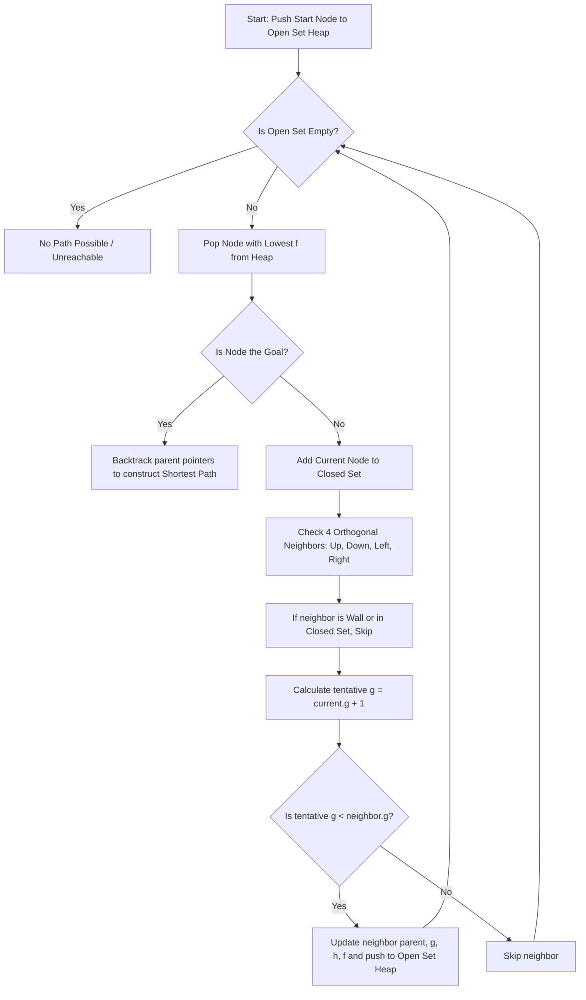

# A* Maze Solver & Pathfinding Visualizer

An interactive pathfinding visualizer and algorithm laboratory built with **HTML5, CSS3, and JavaScript (ES6+)**.

This project provides a clean, step-by-step demonstration of the **A\* Search Algorithm**, featuring live mathematical evaluations ($f(n) = g(n) + h(n)$), real-time priority queue inspection, and an intuitive grid for drawing custom mazes and obstacles.

---

## 30-Second Elevator Pitch (For Presentations & Viva)

> *"This project visualizes the **A\* Search Algorithm** finding the optimal shortest path through a maze. Unlike Dijkstra's algorithm which searches blindly in all directions, A\* uses a **heuristic function (Manhattan distance)** to intelligently guide its search towards the goal. At each step, it chooses the node with the lowest total estimated cost $f(n) = g(n) + h(n)$ from a **Min-Heap Priority Queue**, guaranteeing the shortest path in the fewest expansions possible."*

---

## How to Run the Project

The visualizer is **100% client-side** with zero external dependencies or build steps.

### 1-Click Launch:
Simply **double-click** [index.html](file:///c:/Users/tejas/Documents/tejas/codin/A-Star-Maze/index.html) to open it in any web browser.

Or run from PowerShell:
```powershell
start index.html
```

---

## The Core Mathematics of A*

Every candidate node $n$ is evaluated using the formula:

$$f(n) = g(n) + h(n)$$

| Component | Meaning | How it is Calculated |
|---|---|---|
| **$g(n)$** | **Past Cost** | Exact number of steps taken from the Start node to node $n$. |
| **$h(n)$** | **Future Estimate (Heuristic)** | Estimated distance from node $n$ to Goal using **Manhattan Distance**: $\|r_n - r_{goal}\| + \|c_n - c_{goal}\|$. |
| **$f(n)$** | **Total Estimated Cost** | Sum of $g(n) + h(n)$. The node with the **lowest $f(n)$** is always expanded next. |

### Why Manhattan Distance?
For a 4-directional grid (moving Up, Down, Left, Right), Manhattan distance is:
1. **Admissible**: It never overestimates the true remaining distance ($h(n) \le h^*(n)$).
2. **Consistent (Monotonic)**: It satisfies the triangle inequality, guaranteeing that when the goal is reached, the path found is **mathematically optimal**.

---

## Step-by-Step Algorithm Flow



---

## Code Architecture (How to Walk Through the Code)

The codebase is organized into clean, modular files designed for easy explanation:

```
A-Star-Maze/
├── index.html     # Semantic layout: header metrics, control toolbar, grid canvas, and live math card
├── style.css      # Dark-mode styling, glassmorphism, responsive grid layout
├── script.js     # Clean, well-commented JavaScript engine (~350 lines)
└── README.md      # Algorithm documentation and Viva guide
```

### Breakdown of [script.js](file:///c:/Users/tejas/Documents/tejas/codin/A-Star-Maze/script.js):
1. **Cell Constants**: Defines `EMPTY`, `WALL`, `START`, `GOAL`, `OPEN`, `CLOSED`, `PATH`.
2. **`MinHeap` Class**: Implements a binary min-heap for the Open Set so that popping the node with the lowest $f(n)$ takes $O(\log N)$ time.
3. **`manhattanDistance()`**: Computes $|r_1 - r_2| + |c_1 - c_2|$.
4. **`*aStarGenerator()`**: An ES6 generator function running the core A* algorithm. Yielding at each step enables both automatic smooth animation and single-step manual stepping.
5. **`_render()`**: Draws the grid, active expanding node, cell numbers ($f$-score), and the glowing golden shortest path on the HTML5 Canvas.

---

## Top 5 Viva / Interview Questions & Answers

### 1. What is the fundamental difference between Dijkstra's algorithm and A*?
> **Answer:** Dijkstra's algorithm only considers $g(n)$ (distance traveled so far), expanding equally in all directions like a circle. A* adds a heuristic $h(n)$ (estimated distance to goal), focusing exploration directly towards the target and visiting significantly fewer nodes.

### 2. What makes a heuristic "admissible" and why is it important?
> **Answer:** A heuristic is admissible if it **never overestimates** the actual minimum cost to reach the goal ($h(n) \le h^*(n)$). If $h(n)$ is admissible, A* is mathematically guaranteed to find the optimal shortest path.

### 3. What happens if $h(n) = 0$ everywhere?
> **Answer:** If $h(n) = 0$ for all nodes, the formula becomes $f(n) = g(n) + 0 = g(n)$, which turns A* into **Dijkstra's Algorithm**.

### 4. Why use a Min-Heap instead of a simple Array for the Open Set?
> **Answer:** With a simple array, finding the minimum $f(n)$ node requires a linear scan of $O(N)$ time. A Min-Heap Priority Queue allows extracting the minimum in $O(1)$ lookup and $O(\log N)$ restructuring, making pathfinding much faster on larger grids.

### 5. What are the Time and Space Complexities of A*?
> **Answer:**
> - **Time Complexity:** In the worst case $O(b^d)$ (where $b$ is the branching factor and $d$ is the solution depth), but with a good admissible heuristic like Manhattan distance, it is drastically smaller in practice.
> - **Space Complexity:** $O(b^d)$ because A* must store all frontier nodes in the Open Set and visited nodes in the Closed Set.

---

## Grid Color Legend

| Color | State | Meaning |
|---|---|---|
| Green | Start | Starting position (S) |
| Red | Goal | Target destination (G) |
| Slate | Wall | Impassable obstacle |
| Pink | Current Node | The active node currently being expanded |
| Blue | Open Set (Frontier) | Discovered candidate nodes waiting in the priority queue |
| Dark Slate | Closed Set (Visited) | Explored nodes already evaluated |
| Radiant Gold | Shortest Path | Optimal path reconstructed from Goal to Start |

---

## Keyboard Shortcuts

| Shortcut | Action |
|---|---|
| <kbd>Space</kbd> | Run / Pause Visualizer |
| <kbd>S</kbd> or <kbd>→</kbd> | Step forward one node expansion |
| <kbd>R</kbd> | Reset Search (preserves drawn walls) |
| <kbd>W</kbd> | Select Draw Wall tool |
| <kbd>E</kbd> | Select Erase Wall tool |
